# Lazarus Arc


A cell-grid world simulation in the Dwarf Fortress lineage — built to run cheap, to play
solo or with a hundred others off one codebase, and to wear a 2.5D sprite skin over the
same simulation that drives the terminal.

Written in Rust. ~101,000 lines across nine crates, 723 tests.

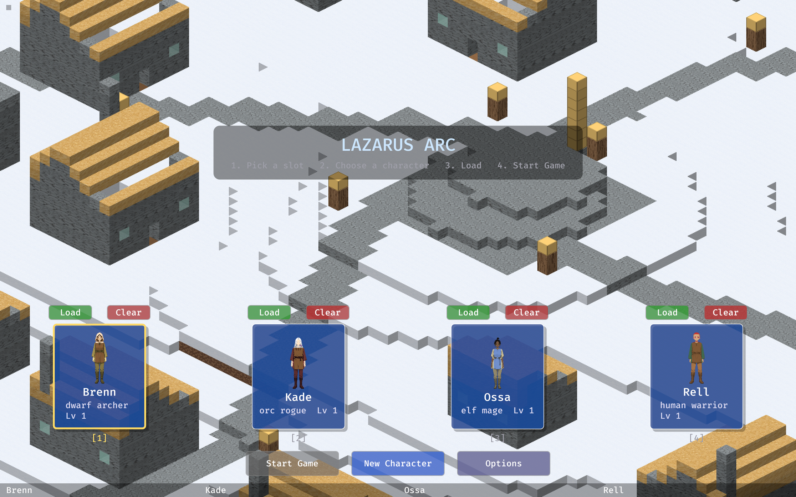

## The idea

One authoritative simulation, two renderers, and no difference between single-player and
multiplayer except which transport the client happens to be holding.

Single-player runs the server on a background thread and talks to it over an in-memory
channel. Multiplayer swaps in a TCP socket. **The simulation never learns which one it is.**

That constraint pays for itself everywhere: the sim is a pure library that takes commands
and emits events, so it tests headlessly with no engine, no window, and no network.

## Two clients, one simulation

The same world, the same tick, the same replicated state — rendered two ways.

A terminal client built on `ratatui`:

```
┌ z 55  view +0 ───────────────────────────────────────┐┌ Lazarus Arc ───────────────────┐
│"",""**"",▒===▒,","""*###################,**,"",,**""#││snapshot                        │
│,*",,,,,,,#===#,",,,,,###################","*,",","","││you 20/20 hp                    │
│,"""",,,*,##+##",,"*,"##################,,",*,"**,",,,││  at 1059 -3428 55   blocks 0   │
│",,,,,*,**,,"",,",*".....,"############,*"",",",",*,*"││  atk 5 def 0  load 5/60        │
│*"",",,"*"",."",,",*.*",""*###########,,*,",,*,,",,",,││  meadow                        │
│",,",",",,,".,,,*"",.,,",",*########,*,****",",","",,,││                                │
│,,,",",,",,,.,.#."*".,*,♠",*",#####"*,,,",,"",,*,,",""││tick 3  10 Hz                   │
│",*,",,"",",.,###*,,.,,,",",",#####,,,,,",",*,,","*,*,││players online 1                │
│,,",,"",,"*".,.#."",.........,#####",*,,*,""*"*"""",,"││chunks 25  in 65 KB             │
│***,"#####,".*,,,*",.",",*,",,#####"*",,,,,,,,",,,""*,││                                │
│,,*,,#####,,.,",,,"".,,"*",,,,#####",,,,,,,"",,",*,*",││                                │
│,,,",#####,".,""",*,.","",",,"#####,,,*"","""*,,,,*",,││                                │
│,,,,,#####",."",*",,.",",,,,,,*,,,,*"*",,""""*"",,*,*"││                                │
│",*,"#####."."","",###",,"",,,"""""""*,,,"",♠,,♠",,",,│└────────────────────────────────┘
│*"",*#####.........#≈#.....@....................**,",,│┌ keys ──────────────────────────┐
│,",",#####."*"",,,"###,,,*.*,,,*"*,"",*"*,,*,"".,,,*,,││arrows/hjkl yubn  move          │
│,,,",*",",."**,,,,,*.,*",".,"",*,,#####","*"",,.,,",,,││x + dir  dig     z  dig down    │
│,,,*,",",,.*,"*".,**.",,",.,,*"*""#####,,*",,",.,,",,"││p + dir  place a block          │
│,"*"**,"",.,"",,"""".",,"".,"",,,,#####,,"*",*,.",*",,││g  pick up    i  inventory      │
│""*,",,"*".",",,"",,............."#####,",,"",,.*,"",,││m  world map                    │
│,,,,,,,"",.""",*""",."*,,#####,,*"#####*,,",,,,."",,,,││< >  view level   0  reset      │
│##▒##",*,,.*"**"*,,".,,",#####",**#####*,",,,*".,"",",││q  quit                         │
│#===#",*,,.,".,,","".",,"#####,,,"#####,"",,,,*.,""","││                                │
│#===+,...............,,""#####","**,"",,,""","".,,,"""││bump a monster to attack        │
│#===#*"*,"*,,",*,,",""",*#####,*,,",,",",,,,",*.***",*│└────────────────────────────────┘
│##▒##",.##+##*",,*","*,""*.",*",,",,""**,*,,"",.",",",│┌ log ───────────────────────────┐
│",*,*,*,#===#,,,,,*,",",,,.,,",,*,,,","*,,",,,,.,,,,,,││connected: world height 160, see│
│",*,"*,,▒===▒*,,,,,,*,,*"*.,,,,*"","*,,","",,,*.*,,,,"││                                │
└──────────────────────────────────────────────────────┘└────────────────────────────────┘
```

...and a 2.5D isometric client built on Bevy, with a rotating camera:

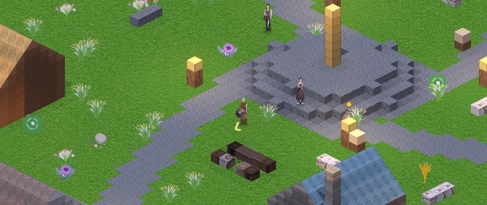

## Light and weather

A real sun moves across the day and casts soft shadows; figures throw their own. Windows
let daylight into rooms in the colour of their glass. Torches flicker, fog veils the
distance, water reflects the world upside down and carries a sky for every weather. Grass
grows blades and the wind moves them. In split-screen, every view gets its own sky.

| | |
|---|---|
| 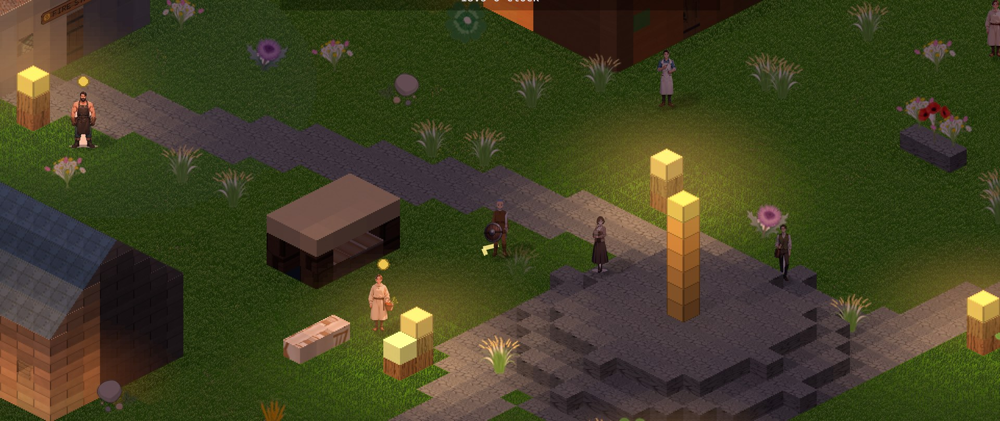 | 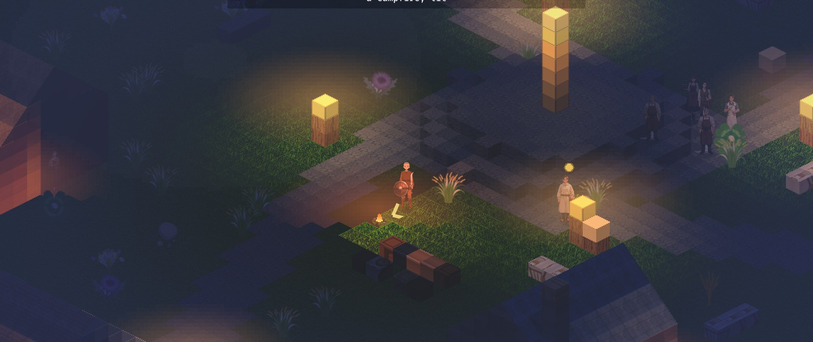 |
| 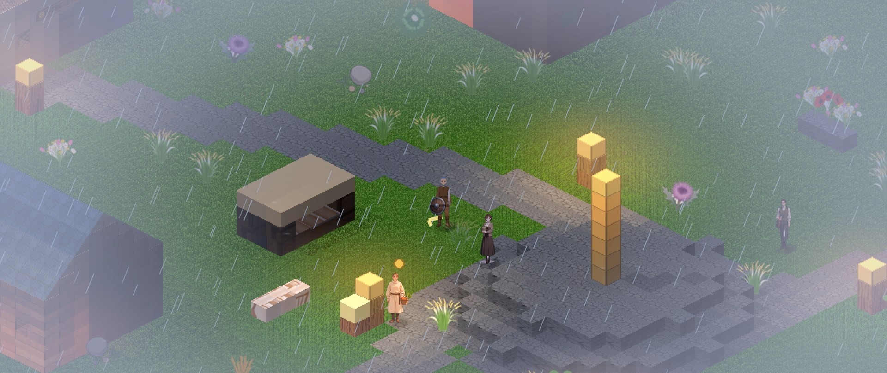 | 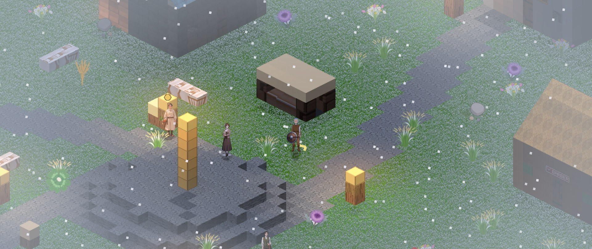 |

## Architecture

| Crate | Responsibility |
|---|---|
| `core` | Shared types: 4-byte cells, positions, commands, events, wire messages, item catalog |
| `sim` | The authoritative simulation. Pure library. Commands in, events out |
| `worldgen` | Seeded terrain, caves, trees — no external noise crates |
| `persist` | SQLite save store: chunks, players, world metadata |
| `server` | Instance server. Area-of-interest replication, autosave, in-memory + TCP transports |
| `client-core` | Replicated client state shared by every renderer |
| `client-term` | Terminal client, launcher, dedicated server, test harness |
| `client-sprite` | 2.5D isometric Bevy client |
| `audio` | 42 composed themes, auditionable from the CLI |

**Stack:** Rust 2021 · Bevy 0.16 · ratatui + crossterm · hecs (ECS) · postcard + lz4_flex
(wire format) · SQLite · serde

## Worldgen

Seeded, deterministic, and written from scratch — no noise crate dependency. Fourteen
biomes, each with its own ground, flora, fauna and weather.

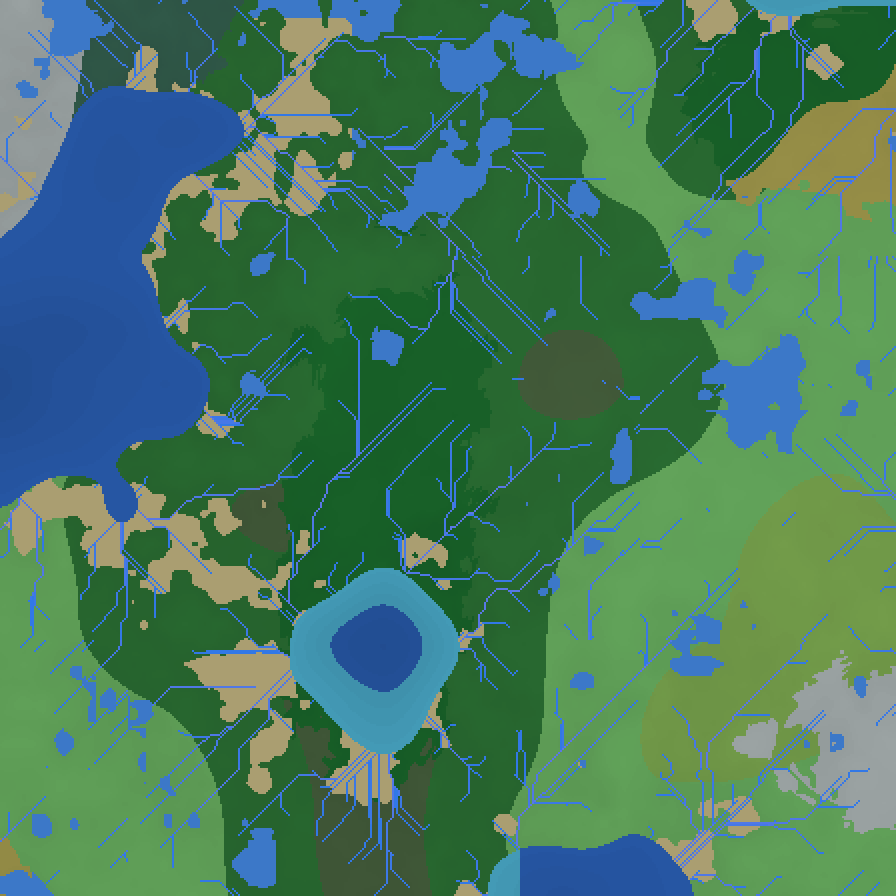

| | |
|---|---|
| 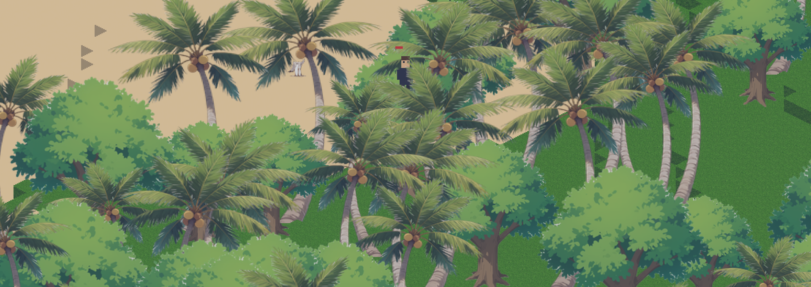 | 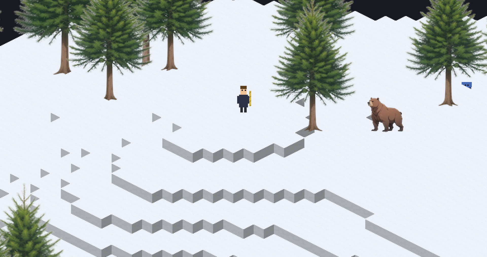 |

Animals are born small, grow, breed, and are hunted.

The ground is alive too. Water holds its volume and finds its level — rivers flow, rain
fills pools, the sun dries them, and floods lift you and leave silt behind. Lava flows,
crusts and sets, and melts snow. Fire leans downwind, burns hot in dry summers and barely
at all in swamps. Undermined ground warns, then falls.

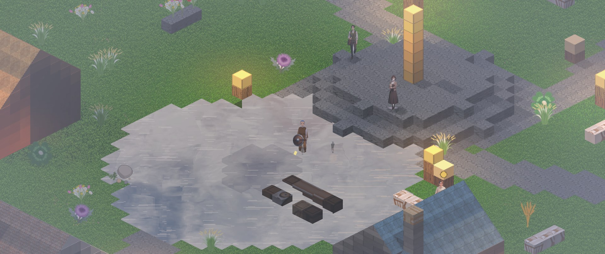

Dig down and the world keeps going: ore veins you can see, caves to the bottom with
glowworm roofs and mushroom groves, old mines that cave in, dwarf outposts some still live
in, storm drains under the town, catacombs under every chapel that wake when the dead are
moved, and desert tombs with a false chamber and a seal you should not break.

## Systems

Character creation — class, race, appearance, starting kit, and two opening skills:

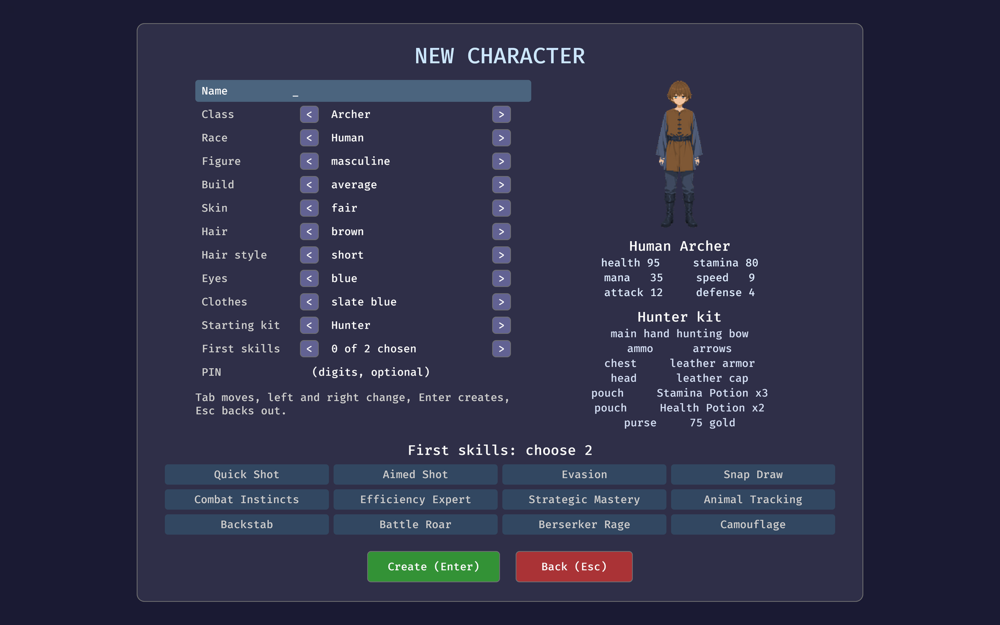

Equipment and progression:

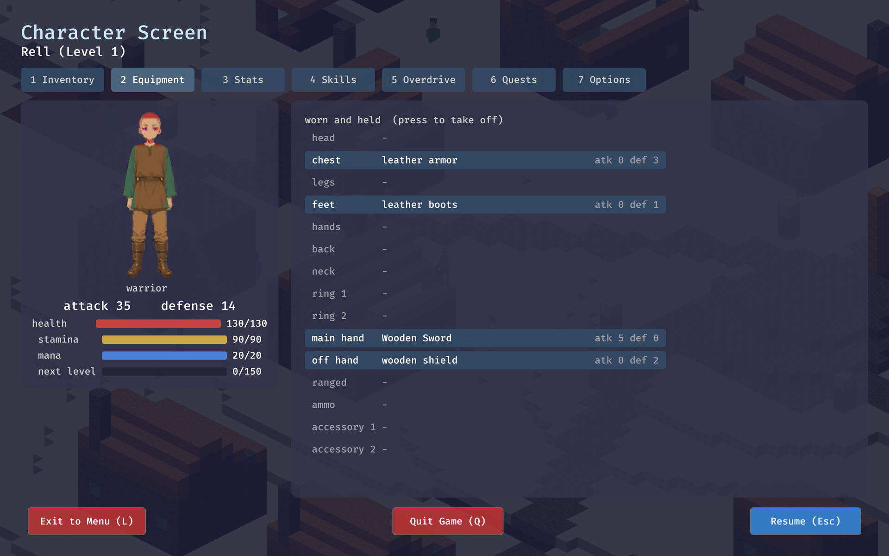

Quests from townsfolk, and a trade economy where shops keep day hours and traveling
merchants shelter inside the gates overnight:

| | |
|---|---|
| 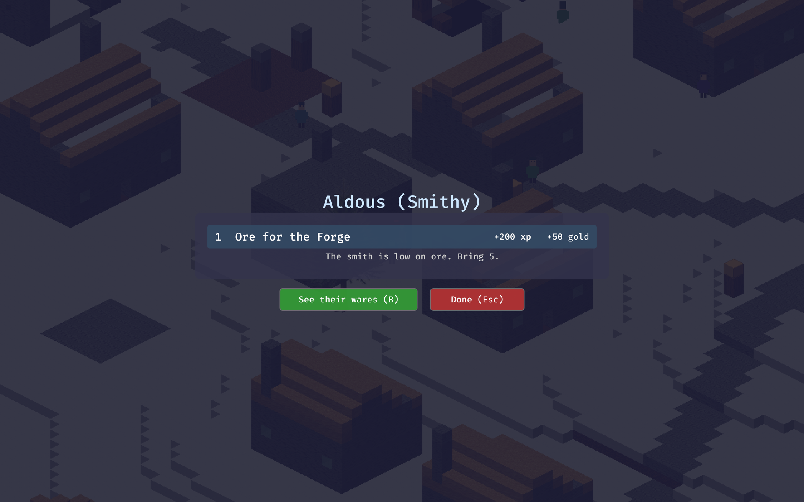 | 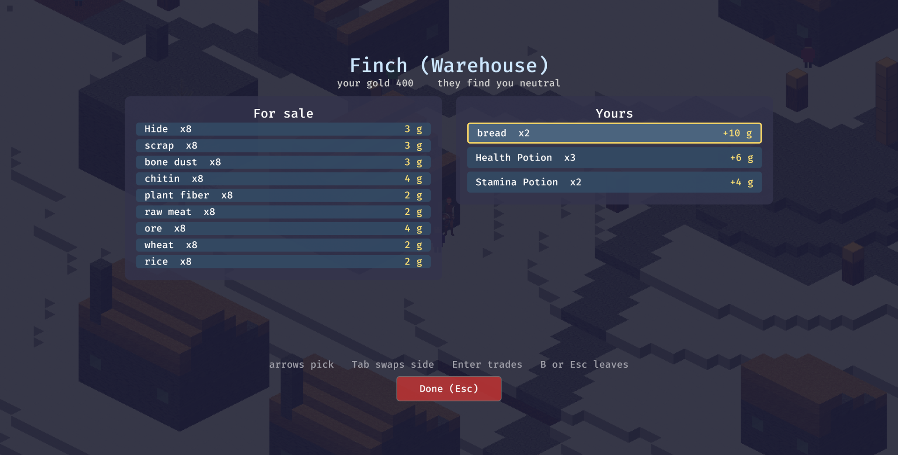 |

Trades climb to level 100 on a RuneScape-style curve. Ten metals mined by depth, ten
grades of wood from trees that grow old, ten fibres and cloths, ten gems — feeding
smithing, leatherworking, pottery, glassmaking, a kitchen of 637 recipes, and a brewhouse:
grain mashed, fermented and stilled into whisky that ages by the hour in oak, apples
pressed to cider, berries left on the skins for red wine, honey and water to mead. Failure costs
what the work costs; at the top grades even a master fails, and pays.

The world has faiths: wild altars, offering bowls you can steal from (with a 20-second
grace to put it back), and powers with moods that remember what was done to them.

In combat, creatures go for whoever hurt them most, a fall in a raid is a down rather
than a respawn, and each weapon reaches as far as it is long.

Beyond the hub town, glowing rifts stand in the field. Step on one and you are sealed into
an arena with a boss, or a wave raid at one of the six gates ringing the hub. The portal
home opens when it is clear.

## Numbers

| | |
|---|---|
| Rust | ~101,000 lines, 9 crates |
| Tests | 723, across 89 files |
| Biomes | 14 |
| Composed themes | 42 |
| Cooking recipes | 637 |
| Trade levels | 100 |
| Renderers | 2, one simulation |

---

*This is a showcase. The source repository is private — the design documents, story bible
and roadmap are the part worth keeping. Happy to walk through the architecture on request.*
