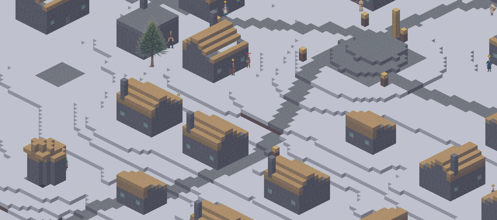

# Lazarus Arc

A cell-grid world simulation in the Dwarf Fortress lineage — built to run cheap, to play
solo or with a hundred others off one codebase, and to wear a 2.5D sprite skin over the
same simulation that drives the terminal.

Written in Rust. ~27,000 lines across nine crates, 176 tests.


## The idea

One authoritative simulation, two renderers, and no difference between single-player and
multiplayer except which transport the client happens to be holding.

Single-player runs the server on a background thread and talks to it over an in-memory
channel. Multiplayer swaps in a TCP socket. **The simulation never learns which one it is.**

That constraint pays for itself everywhere: the sim is a pure library that takes commands
and emits events, so it tests headlessly with no engine, no window, and no network.

## Two clients, one simulation

The same world, the same tick, the same replicated state — rendered two ways.

A terminal client built on `ratatui`:

```
┌ z 55  view +0 ───────────────────────────────────────┐┌ Lazarus Arc ───────────────────┐
│"",""**"",▒===▒,","""*###################,**,"",,**""#││snapshot                        │
│,*",,,,,,,#===#,",,,,,###################","*,",","","││you 20/20 hp                    │
│,"""",,,*,##+##",,"*,"##################,,",*,"**,",,,││  at 1059 -3428 55   blocks 0   │
│",,,,,*,**,,"",,",*".....,"############,*"",",",",*,*"││  atk 5 def 0  load 5/60        │
│*"",",,"*"",."",,",*.*",""*###########,,*,",,*,,",,",,││  meadow                        │
│",,",",",,,".,,,*"",.,,",",*########,*,****",",","",,,││                                │
│,,,",",,",,,.,.#."*".,*,♠",*",#####"*,,,",,"",,*,,",""││tick 3  10 Hz                   │
│",*,",,"",",.,###*,,.,,,",",",#####,,,,,",",*,,","*,*,││players online 1                │
│,,",,"",,"*".,.#."",.........,#####",*,,*,""*"*"""",,"││chunks 25  in 65 KB             │
│***,"#####,".*,,,*",.",",*,",,#####"*",,,,,,,,",,,""*,││                                │
│,,*,,#####,,.,",,,"".,,"*",,,,#####",,,,,,,"",,",*,*",││                                │
│,,,",#####,".,""",*,.","",",,"#####,,,*"","""*,,,,*",,││                                │
│,,,,,#####",."",*",,.",",,,,,,*,,,,*"*",,""""*"",,*,*"││                                │
│",*,"#####."."","",###",,"",,,"""""""*,,,"",♠,,♠",,",,│└────────────────────────────────┘
│*"",*#####.........#≈#.....@....................**,",,│┌ keys ──────────────────────────┐
│,",",#####."*"",,,"###,,,*.*,,,*"*,"",*"*,,*,"".,,,*,,││arrows/hjkl yubn  move          │
│,,,",*",",."**,,,,,*.,*",".,"",*,,#####","*"",,.,,",,,││x + dir  dig     z  dig down    │
│,,,*,",",,.*,"*".,**.",,",.,,*"*""#####,,*",,",.,,",,"││p + dir  place a block          │
│,"*"**,"",.,"",,"""".",,"".,"",,,,#####,,"*",*,.",*",,││g  pick up    i  inventory      │
│""*,",,"*".",",,"",,............."#####,",,"",,.*,"",,││m  world map                    │
│,,,,,,,"",.""",*""",."*,,#####,,*"#####*,,",,,,."",,,,││< >  view level   0  reset      │
│##▒##",*,,.*"**"*,,".,,",#####",**#####*,",,,*".,"",",││q  quit                         │
│#===#",*,,.,".,,","".",,"#####,,,"#####,"",,,,*.,""","││                                │
│#===+,...............,,""#####","**,"",,,""","".,,,"""││bump a monster to attack        │
│#===#*"*,"*,,",*,,",""",*#####,*,,",,",",,,,",*.***",*│└────────────────────────────────┘
│##▒##",.##+##*",,*","*,""*.",*",,",,""**,*,,"",.",",",│┌ log ───────────────────────────┐
│",*,*,*,#===#,,,,,*,",",,,.,,",,*,,,","*,,",,,,.,,,,,,││connected: world height 160, see│
│",*,"*,,▒===▒*,,,,,,*,,*"*.,,,,*"","*,,","",,,*.*,,,,"││                                │
└──────────────────────────────────────────────────────┘└────────────────────────────────┘
```

...and a 2.5D isometric client built on Bevy, with a rotating camera:



## Architecture

| Crate | Responsibility |
|---|---|
| `core` | Shared types: 4-byte cells, positions, commands, events, wire messages, item catalog |
| `sim` | The authoritative simulation. Pure library. Commands in, events out |
| `worldgen` | Seeded terrain, caves, trees — no external noise crates |
| `persist` | SQLite save store: chunks, players, world metadata |
| `server` | Instance server. Area-of-interest replication, autosave, in-memory + TCP transports |
| `client-core` | Replicated client state shared by every renderer |
| `client-term` | Terminal client, launcher, dedicated server, test harness |
| `client-sprite` | 2.5D isometric Bevy client |
| `audio` | 42 composed themes, auditionable from the CLI |

**Stack:** Rust 2021 · Bevy 0.16 · ratatui + crossterm · hecs (ECS) · postcard + lz4_flex
(wire format) · SQLite · serde

## Worldgen

Seeded, deterministic, and written from scratch — no noise crate dependency. Fourteen
biomes, each with its own ground, flora, fauna and weather.


| | |
|---|---|
|  |  |

Animals are born small, grow, breed, and are hunted.

## Systems

Character creation — class, race, appearance, starting kit, and two opening skills:


Equipment and progression:


Quests from townsfolk, and a trade economy where shops keep day hours and traveling
merchants shelter inside the gates overnight:

| | |
|---|---|
|  |  |

Beyond the hub town, glowing rifts stand in the field. Step on one and you are sealed into
an arena with a boss, or a wave raid at one of the six gates ringing the hub. The portal
home opens when it is clear.

## Numbers

| | |
|---|---|
| Rust | ~27,000 lines, 9 crates |
| Tests | 176, across 31 files |
| Biomes | 14 |
| Composed themes | 42 |
| Renderers | 2, one simulation |

---

*This is a showcase. The source repository is private — the design documents, story bible
and roadmap are the part worth keeping. Happy to walk through the architecture on request.*
